# EmuPipeline

**EmuPipeline cleans up and prepares your retro game library.** It puts ROMs in order, matches game pictures to the correct games, makes images and videos smaller, and writes the list file that your game menu needs.

[](https://github.com/rtasistemas/evs/actions)
[](https://python.org)
[](pyproject.toml)

Version 5.0 · Linux (made for Bazzite, EmuDeck, and Steam Deck) · FBNeo and MAME arcade sets

---

## Contents

1. [What EmuPipeline does](#1-what-emupipeline-does)
2. [Words you must know](#2-words-you-must-know)
3. [Quick start](#3-quick-start)
4. [Install](#4-install)
5. [Prepare your folders](#5-prepare-your-folders)
6. [How the pipeline works](#6-how-the-pipeline-works)
7. [The steps in detail](#7-the-steps-in-detail)
8. [Safe modes: dry run and audit](#8-safe-modes-dry-run-and-audit)
9. [Command line](#9-command-line)
10. [Text interface (TUI)](#10-text-interface-tui)
11. [Configuration reference](#11-configuration-reference)
12. [Output files and logs](#12-output-files-and-logs)
13. [Troubleshooting](#13-troubleshooting)
14. [For developers](#14-for-developers)
15. [Glossary](#15-glossary)

---

## 1. What EmuPipeline does

You can have thousands of game files. They have different names. They are in different folders. Some files are too large. Some pictures have no game.

EmuPipeline does this work for you. You start it one time. It does each task in the correct order.

| Before | After |
|---|---|
| ROMs are in no special order | ROMs are sorted and named correctly |
| Pictures have random names | Each picture is linked to its game |
| PNG pictures are large | WebP pictures are about 70% smaller |
| Videos use different codecs | Videos use H.265 (small and good quality) |
| No game list exists | A `gamelist.xml` file exists for EmulationStation |
| Ports have no launcher | Each port has a `.desktop` launcher |

### Who needs this tool

Use EmuPipeline if you:

- keep a large arcade or console ROM library;
- use EmulationStation, EmuDeck, or a Steam Deck;
- want one repeatable process, not many manual tasks.

### Safety

EmuPipeline can delete files. Therefore it has two safe modes. In these modes, it does **not** change your files. Read [section 8](#8-safe-modes-dry-run-and-audit) before your first real run.

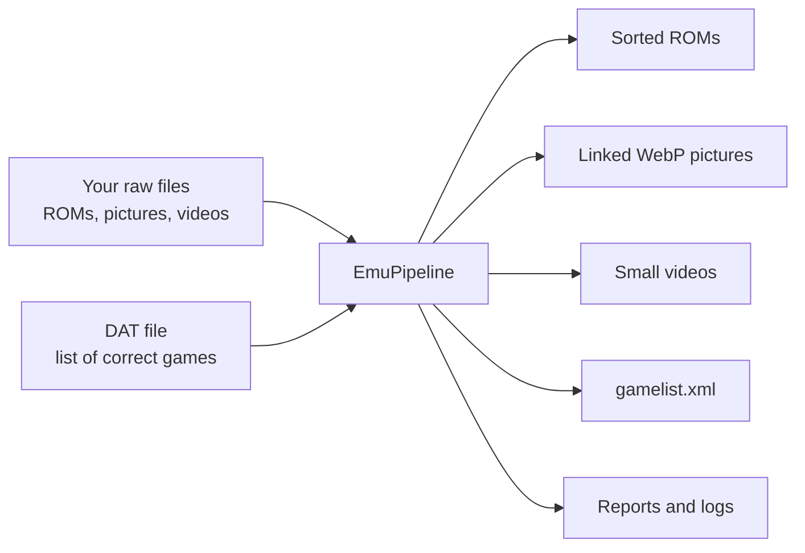

---

## 2. Words you must know

You do not need earlier knowledge. These six words appear in the whole document.

| Word | Meaning |
|---|---|
| **ROM** | A file that holds a game. Most are `.zip` files. |
| **DAT file** | An XML file that lists every correct game and its checksum. FBNeo, MAME, and Redump publish them. |
| **Driver** | The hardware that a game runs on, for example `cps1` or `neogeo`. The DAT file gives the driver. |
| **Clone** | A game that is a copy of another game (the *parent*) with small changes. |
| **Step** | One task in the pipeline, for example "convert pictures". There are 13 steps. |
| **Pipeline** | A group of steps that run one after the other. |

More terms are in the [glossary](#15-glossary).

---

## 3. Quick start

You need Python 3.10 or newer. Run these commands in a terminal.

```bash
# 1. Get the code
git clone https://github.com/rtasistemas/evs.git
cd evs

# 2. Install the program with all Python extras
pip install -e ".[full]"

# 3. Make your config file, then edit it
cp config.yaml.example config.yaml
$EDITOR config.yaml

# 4. Check that all tools are installed
emupipeline --check-env

# 5. Do a test run. This does not change any file.
emupipeline --pipeline --dry-run

# 6. Do the real run
emupipeline --pipeline
```

If you are not sure, run `emupipeline` with no options. A menu opens. Choose one step at a time.

---

## 4. Install

### 4.1 Python packages

EmuPipeline needs only `pyyaml`. Other packages are optional. Use extras to add them.

| Command | What it adds | Why you need it |
|---|---|---|
| `pip install emupipeline` | `pyyaml` only | Basic use |
| `pip install "emupipeline[images]"` | Pillow | Convert pictures to WebP |
| `pip install "emupipeline[validation]"` | Pydantic 2 | Full check of `config.yaml` |
| `pip install "emupipeline[tui]"` | Textual | The text interface |
| `pip install "emupipeline[full]"` | All of the above | Recommended |
| `pip install -e ".[dev]"` | Test and lint tools | For developers |

### 4.2 External programs

Some steps call other programs. Install only the programs for the steps that you use.

| Program | Used by step | Needed? | Install note |
|---|---|---|---|
| `igir` 1.8 or newer | Organize ROMs | If you use that step | `npm install -g igir` (needs Node.js 18+) |
| `ffmpeg` and `ffprobe` | Optimize videos | If you use that step | `sudo dnf install ffmpeg` |
| `chdman` | Compress ROMs (CHD) | If you use that step | Part of the MAME tools |
| `DolphinTool` | Compress ROMs (RVZ) | If you use that step | Part of Dolphin |
| `maxcso` | Compress ROMs (CSO) | If you use that step | Package `maxcso` |
| `waifu2x-ncnn-vulkan` or `realesrgan-ncnn-vulkan` | Upscale pictures | If you use that step | Download from GitHub |
| ImageMagick 7 (`magick`) | Upscale sharpening | Optional | `sudo dnf install ImageMagick` |
| `wine`, `gamemoderun`, `mangohud` | Port launchers | Optional | Use your package manager |

Run `emupipeline --check-env` to see which programs your computer has. The command shows a table and a hint for each missing program.

---

## 5. Prepare your folders

EmuPipeline reads the paths from `config.yaml`. Paths that are not absolute start from `global.base_dir`.

This is the layout in `config.yaml.example`:

```text
~/Documents/emupipeline/          <- global.base_dir
├── dats/
│   ├── FinalBurn Neo (...).dat   <- paths.dat_file
│   └── catver.ini                <- paths.catver_ini (game categories)
├── source/                       <- INPUT. EmuPipeline reads from here.
│   ├── roms/                     <- paths.input_roms
│   └── images/                   <- paths.input_imgs
└── output/                       <- OUTPUT. EmuPipeline writes to here.
    ├── roms/                     <- paths.output_roms
    ├── images/                   <- paths.output_imgs
    ├── dats_generated/           <- paths.output_dats
    ├── reports/                  <- paths.output_reports
    ├── logs/                     <- paths.output_logs
    └── gamelist.xml              <- paths.output_xml
```

**Important:** Put the DAT file in place before you start. Three steps need it (validate ROMs, organize pictures, make `gamelist.xml`). Two more steps read it themselves (split DAT, organize ROMs).

---

## 6. How the pipeline works

The automatic pipeline runs **8 steps**. They always run in this order.

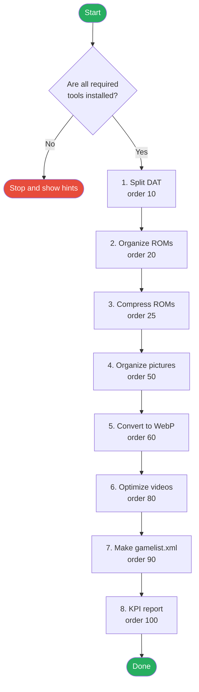

Note: The environment check in this diagram runs when you choose **99** in the menu. The command `emupipeline --pipeline` does not run it. Run `emupipeline --check-env` yourself before `--pipeline`.

### Manual steps

Five more steps are **not** in the automatic pipeline. You start them yourself, because they take long, need extra programs, or delete data.

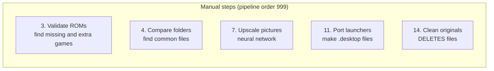

### What each step gives to the next step

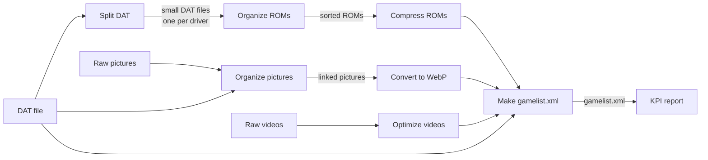

### What happens when a step fails

| Command | Behavior |
|---|---|
| `emupipeline --pipeline` | Stops at the first error (default). |
| `emupipeline --pipeline --continue-on-error` | Writes the error to the log and runs the next step. |
| Menu option 99 | Asks you if it must continue. |

---

## 7. The steps in detail

Each step has a **menu number**. Use it with `--step N`.

| Menu # | Name | ID | In pipeline? | Needs DAT? | Group |
|---|---|---|---|---|---|
| 1 | Split DAT | `dat_split` | Yes (10) | No* | ROMs & DATs |
| 2 | Organize ROMs | `rom_manager` | Yes (20) | No* | ROMs & DATs |
| 3 | Validate ROMs | `validate_roms` | No | Yes | ROMs & DATs |
| 4 | Compare folders | `compare_folders` | No | No | ROMs & DATs |
| 5 | Organize pictures | `organize_images` | Yes (50) | Yes | Images |
| 6 | Convert to WebP | `convert_webp` | Yes (60) | No | Images |
| 7 | Upscale pictures | `upscale_images` | No | No | Images |
| 8 | Optimize videos | `optimize_videos` | Yes (80) | No | Video & Metadata |
| 9 | Make gamelist.xml | `generate_metadata` | Yes (90) | Yes | Video & Metadata |
| 10 | KPI report | `kpi_report` | Yes (100) | No | Video & Metadata |
| 11 | Port launchers | `ports_launchers` | No | No | Extras |
| 12 | Compress ROMs | `compress_roms` | Yes (25) | No | ROMs & DATs |
| 14 | Clean originals | `clean_originals` | No | No | Images |

\* These steps read the DAT file themselves, from `paths.dat_file`.
Menu number 13 is not in use.

Run `emupipeline --list-steps` to see this table from your installed version.

### 7.1 Split DAT (`dat_split`)

**Goal:** Cut the large master DAT into small DAT files, one for each driver. Remove games that you do not want.

**Input:** `paths.dat_file` · **Output:** `paths.output_dats`

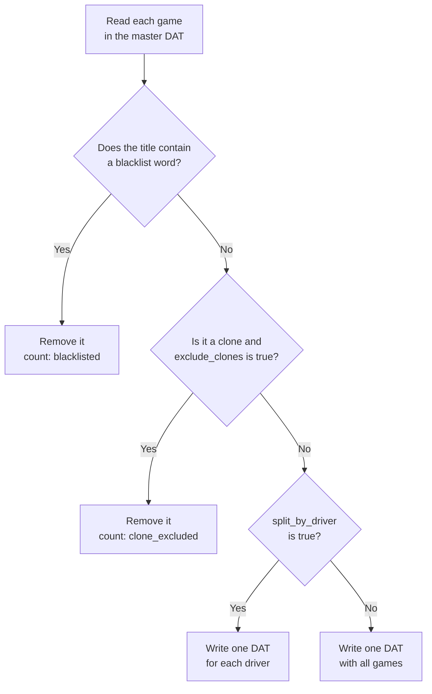

**Settings:** `roms.split_by_driver`, `roms.blacklist`, `roms.exclude_clones`, `roms.generate_bios_file`, `roms.combined_filename`.

### 7.2 Organize ROMs (`rom_manager`)

**Goal:** Check, rename, and sort your ROMs against the DAT files. This step calls the program **igir**.

**Input:** `paths.input_roms` and the DAT files · **Output:** `paths.output_roms`

The setting `roms.merge_mode` controls how clones are stored:

| Mode | Meaning |
|---|---|
| `nonmerged` | Each ZIP file holds everything that the game needs. Uses more space. Easiest. **Recommended for EmuDeck.** |
| `split` | A clone ZIP holds only the files that are different from its parent. |
| `merged` | The parent and all clones are in one ZIP. |

If `igir` is not installed, the step writes an error and stops. Set `roms.enable_igir: false` to skip it.

### 7.3 Validate ROMs (`validate_roms`) — manual

**Goal:** Tell you which games are missing from your collection and which files are not in the DAT.

It compares the names of the `.zip` files in `paths.input_roms` with the names in the DAT. It writes `validation_report.txt` to `paths.output_reports`.

### 7.4 Compare folders (`compare_folders`) — manual

**Goal:** Show which files two folders have in common and which files are only in one folder.

If `compare.copy_common` is `true`, the step copies the common files to `compare.output_dir`.

> **Warning:** The step **deletes** `compare.output_dir` and makes it again each time it runs. Do not put your own files in that folder.

### 7.5 Organize pictures (`organize_images`)

**Goal:** Give each picture to the correct game. Picture names are often wrong, so the step tries three ways, from exact to fuzzy.

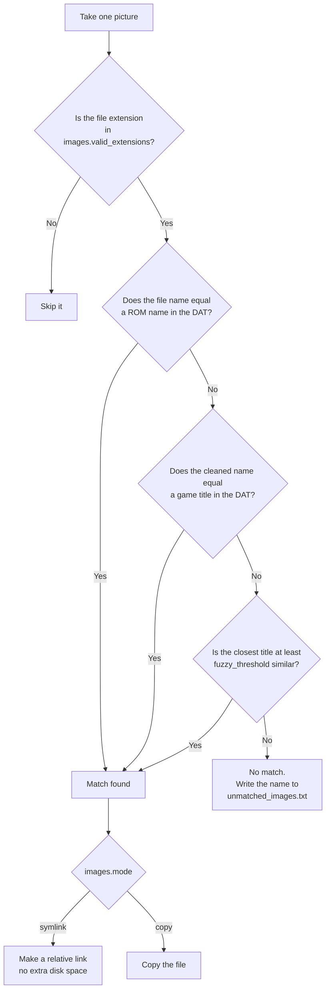

**How names are cleaned before the fuzzy test:** The step removes tags such as `(USA)` or `[!]`, changes letters to lowercase, and removes punctuation and extra spaces.

**Pick a good `images.fuzzy_threshold`:**

| Value | Result |
|---|---|
| `1.0` | Only exact cleaned names match. |
| `0.80` | Good balance. **Default.** |
| `0.0` | Everything matches. Many wrong matches. Do not use. |

### 7.6 Convert to WebP (`convert_webp`)

**Goal:** Change PNG and JPG pictures to WebP. The result is about 70% smaller and looks the same.

- The step uses many processes at the same time. This makes it fast.
- It skips a picture when the `.webp` file already exists.
- It does **not** delete the originals. Use step 14 for that.
- `webp.quality` is a number from 1 to 100. The default is 85.

### 7.7 Upscale pictures (`upscale_images`) — manual

**Goal:** Make small pictures larger (2× or 4×) with a neural network.

| Setting | Meaning |
|---|---|
| `upscale.engine` | `waifu2x` (best for 2D art and pixel art) or `realesrgan` (best for 3D and photos). If `null`, the program asks you. |
| `upscale.scale` | `2` or `4`. Scale `4` needs about four times more video memory. |
| `upscale.post_process` | If `true`, ImageMagick sharpens each result. |

You need a GPU that supports Vulkan. If the program file in `paths.bin_waifu2x` or `paths.bin_realesrgan` is missing, the step writes an error and stops.

### 7.8 Optimize videos (`optimize_videos`)

**Goal:** Make videos smaller with ffmpeg. Use H.265 (default) or H.264.

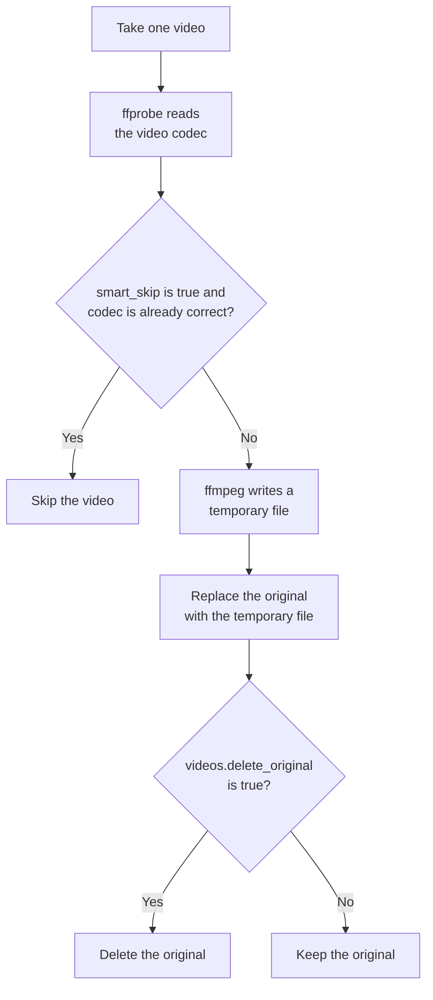

- `videos.crf` sets quality. Lower is better and larger. `28` is good for retro videos.
- The program writes the new file first and replaces the old file only at the end. A crash cannot leave a broken video.
- ffmpeg uses many CPU cores. Therefore the step uses only half of `global.threads` for its own workers.

### 7.9 Make gamelist.xml (`generate_metadata`)

**Goal:** Write the `gamelist.xml` file that EmulationStation reads. It lists each game with its name, picture, video, and category. The categories come from `catver.ini`.

**Output:** `paths.output_xml`

### 7.10 KPI report (`kpi_report`)

**Goal:** Show how many files each folder has and how much disk space it uses. It writes `kpi.csv` to `paths.output_reports`.

### 7.11 Port launchers (`ports_launchers`) — manual

**Goal:** Make a launcher for each "port" (a native Linux game or a Windows game that runs with Wine).

Each sub-folder of `ports.source_dir` is one port. For each port, the step finds the main program and writes two files to `ports.output_dir`: `autorun.sh` and a `.desktop` file.

| Port type | What the step looks for | What runs |
|---|---|---|
| Linux | An executable file, or a `.sh` file | The file directly |
| Windows | A file in `ports.windows_extensions` (default `.exe`) | The file with `ports.windows_runner` (default `wine`) |

Options `ports.enable_gamemode` and `ports.enable_mangohud` add `gamemoderun` and `mangohud` before the command. For Windows ports, `ports.windows_environment` sets extra variables such as `ESYNC` and `FSYNC`.

### 7.12 Compress ROMs (`compress_roms`)

**Goal:** Change large disc images into small formats, as EmuDeck does. The step finds the system from the **name of the sub-folder** in `paths.input_roms`.

| Format | Sub-folder names | Program |
|---|---|---|
| **CHD** | `ps1`, `psx`, `ps2`, `dreamcast`, `saturn`, `segacd`, `3do`, `neogeocd`, `pcenginecd`, `cd32` | `chdman` |
| **RVZ** | `gamecube`, `wii` | `DolphinTool` |
| **CSO** or **ZSO** | `psp` | `maxcso` |

- Sub-folders with other names are ignored.
- If the program for a format is missing, the step skips that system and writes a warning.
- If the compressed file exists, the step skips it.
- `compress.delete_original` is `false` by default. If you set it to `true`, the step deletes the source files after a good result.

### 7.13 Clean originals (`clean_originals`) — manual

> **This step deletes files. You cannot undo it.**

**Goal:** Delete PNG and JPG pictures after a good WebP version exists.

The step looks in `paths.output_imgs`. It deletes a picture only if a `.webp` file with the same name is in the same folder and is a valid file (more than 50 bytes). It asks you to type `DELETAR` before it deletes anything. It does not run without a terminal.

Before you run it, do this:

1. Run `emupipeline --step 14 --dry-run` and read the list.
2. Open some WebP files and check them.
3. Make a backup if the pictures are important.

---

## 8. Safe modes: dry run and audit

Every step supports three modes.

| Mode | Option | Changes files? | What you get |
|---|---|---|---|
| Normal | *(none)* | **Yes** | The real result |
| Dry run | `--dry-run` | No | Log lines that say what the step would do |
| Audit | `--audit` | No | The log, and a report of all planned actions |

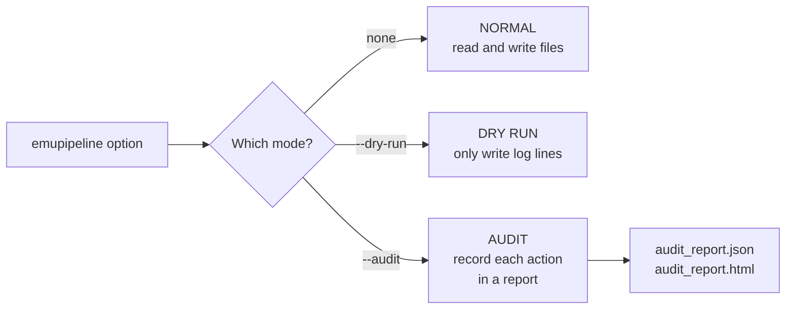

**Use this routine for each new library:**

1. Run `emupipeline --pipeline --dry-run`.
2. Run `emupipeline --pipeline --audit`. Open `audit_report.html` in `paths.output_reports`.
3. Read the list of actions. Look at the deletions with care.
4. Run `emupipeline --pipeline`.

Audit and dry-run modes only simulate the work. A step that needs the result of an earlier step can show less data in these modes.

---

## 9. Command line

```text
emupipeline [options]
```

| Option | Meaning |
|---|---|
| *(no option)* | Open the menu. |
| `--pipeline` | Run the 8 automatic steps. |
| `--step N` | Run one step. `N` is the menu number. |
| `--list-steps` | Show all steps and exit. |
| `--skip N[,N...]` | With `--pipeline`: skip these steps. Example: `--skip 6,8`. |
| `--stop-on-error` | With `--pipeline`: stop at the first error. This is the default. |
| `--continue-on-error` | With `--pipeline`: run the next step after an error. |
| `--dry-run` | Do not change files. |
| `--audit` | Do not change files. Make an audit report. |
| `--config PATH` | Use this config file. |
| `--threads N` | Replace `global.threads` for this run. |
| `--check-env` | Check the external programs, then exit. |
| `--tui` | Open the text interface. |
| `--version` | Show the version. |

### Examples

```bash
# Test the full pipeline without any change
emupipeline --pipeline --dry-run

# Run the full pipeline, but skip video optimization (8)
emupipeline --pipeline --skip 8

# Convert pictures with 12 workers
emupipeline --step 6 --threads 12

# Use a different config file
emupipeline --config ~/other/config.yaml --pipeline

# Open the menu
emupipeline
```

### The menu

The menu shows all steps in groups. Type a number and press Enter.

- A step number runs that step.
- `99` runs the full pipeline. It first checks the tools. If a step fails, it asks if it must continue.
- `0` exits.

### How the program finds `config.yaml`

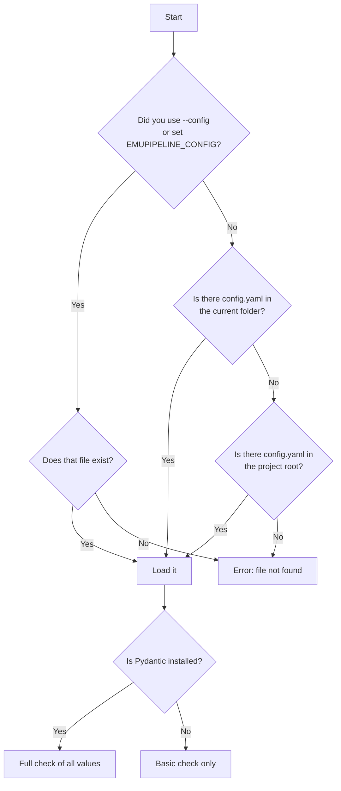

If a value is wrong, the program shows the field name, the value, and the reason. It then stops before any work starts.

---

## 10. Text interface (TUI)

The TUI shows the pipeline in your terminal. You see the steps, a live log, a progress bar, and statistics.

```bash
pip install "emupipeline[tui]"
emupipeline --tui              # normal mode
emupipeline --tui --dry-run    # start in dry-run mode
```

```text
┌ EmuPipeline v5.0 ────────────────────────────────────────┐
│ Mode: DRY-RUN                                            │
├───────────────┬──────────────────────────────────────────┤
│ STEPS         │ [2/8] Organize ROMs  ████░░░░░░░░         │
│  ✓ Split DAT  │ LOG                                      │
│  ► Organize.. │ 12:34:06 INFO RomManager Start...        │
│  ○ Convert .. │                                          │
│               │ STATISTICS                               │
│               │ dats_created   4                         │
├───────────────┴──────────────────────────────────────────┤
│ p Pipeline  d Dry-run  a Audit  c Clear log  q Quit      │
└──────────────────────────────────────────────────────────┘
```

| Key | Action |
|---|---|
| `p` | Start the pipeline |
| `d` | Switch dry-run mode on or off |
| `a` | Switch audit mode on or off |
| `c` | Clear the log |
| `Esc` | Cancel the run |
| `q` | Quit |

Symbols in the step list: `○` waiting, `►` running, `✓` done, `✗` error, `–` skipped.

To change the colors, edit the `CSS` text at the top of `src/emupipeline/tui.py`. You can also set a Textual theme in the app class, for example `THEME = "nord"`.

---

## 11. Configuration reference

The file `config.yaml.example` has a comment for each setting. Copy it to `config.yaml` and change the values.

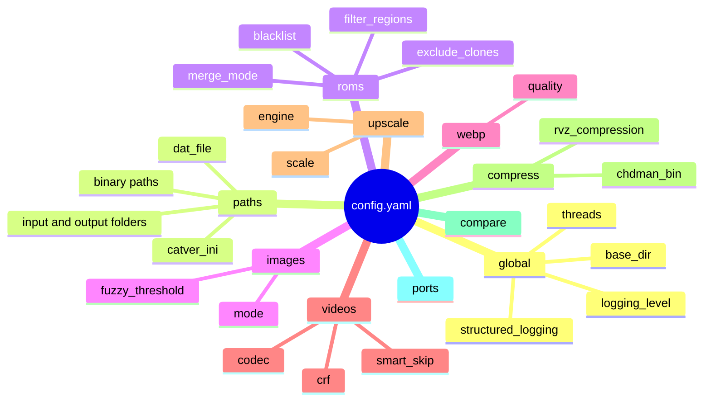

### Main settings

| Section | Key | Default in example | Meaning |
|---|---|---|---|
| `global` | `base_dir` | `~/Documents/emupipeline` | Root folder. Relative paths start here. |
| `global` | `logging_level` | `INFO` | `DEBUG`, `INFO`, `WARNING`, or `ERROR`. |
| `global` | `threads` | `8` | Number of parallel workers. Use your CPU core count. |
| `global` | `structured_logging` | `false` | `true` writes the log file as JSON. |
| `roms` | `merge_mode` | `nonmerged` | `nonmerged`, `split`, or `merged`. |
| `roms` | `filter_regions` | `WORLD,BRA,USA,EUR,JPN` | Region order of preference. |
| `roms` | `exclude_clones` | `true` | Remove clone games. |
| `roms` | `blacklist` | list of words | Remove games with these words in the title. |
| `roms` | `threads_io` | `4` | IGIR threads. Use 2–4 for an HDD, up to 8 for an SSD. |
| `images` | `mode` | `symlink` | `symlink` or `copy`. Use `copy` for external disks. |
| `images` | `organization_mode` | `subfolders` | `subfolders` (by driver) or `flat`. |
| `images` | `fuzzy_threshold` | `0.80` | From 0.0 to 1.0. |
| `webp` | `quality` | `85` | From 1 to 100. |
| `videos` | `codec` | `libx265` | `libx265` or `libx264`. |
| `videos` | `crf` | `28` | From 0 to 51. Lower is better quality. |
| `videos` | `smart_skip` | `true` | Skip videos that already have the target codec. |
| `videos` | `delete_original` | `true` | Delete the old video after a good result. |
| `upscale` | `engine` | `null` | `waifu2x`, `realesrgan`, or `null` (ask). |
| `upscale` | `scale` | `2` | `2` or `4`. |
| `compress` | `delete_original` | `false` | Delete the source disc image after a good result. |
| `compress` | `output_dir` | `""` | Empty means "in the same folder". |
| `compress` | `rvz_compression` | `zstd` | `zstd`, `bzip2`, `lzma`, `lzma2`, or `none`. |
| `compress` | `rvz_level` | `5` | From 1 to 9. |
| `compress` | `psp_format` | `cso` | `cso` or `zso`. |

> **Check delete settings.** `videos.delete_original` and `compress.delete_original` can delete your files. Set them to `false` until you trust the result. In the example file, `videos.delete_original` is `true`.

### Environment variable

| Variable | Meaning |
|---|---|
| `EMUPIPELINE_CONFIG` | Full path to a config file. The `--config` option sets this variable. |

---

## 12. Output files and logs

| File | Made by | Folder | Content |
|---|---|---|---|
| `pipeline.log` | All steps | `paths.output_logs` | The full log. Old files rotate automatically. |
| `*.dat` | Split DAT | `paths.output_dats` | Small DAT files. |
| `gamelist.xml` | gamelist step | `paths.output_xml` | Game list for EmulationStation. |
| `validation_report.txt` | Validate ROMs | `paths.output_reports` | Missing and extra games. |
| `unmatched_images.txt` | Organize pictures | `paths.output_reports` | Pictures with no game. |
| `kpi.csv` | KPI report | `paths.output_reports` | File counts and disk use. |
| `metrics.json` | `--pipeline` | `paths.output_reports` | Time and counts for each step. |
| `audit_report.json`, `audit_report.html` | `--audit` with `--pipeline` | `paths.output_reports` | List of planned actions. |

### Log format

In the default setting, log lines are plain text. Set `global.structured_logging: true` to write JSON lines in the log file. Each JSON line has these fields:

| Field | Meaning |
|---|---|
| `ts`, `level`, `logger`, `msg`, `thread` | Time, severity, source, message, thread ID |
| `run_id` | A random ID. It is the same for all lines in one run. Use it to find all lines of one run. |
| `step`, `file`, `duration_s`, `stats` | Added when the log line has them |

---

## 13. Troubleshooting

| Problem | Cause | Solution |
|---|---|---|
| `EMUPIPELINE_CONFIG aponta para arquivo inexistente` | The path in the variable is wrong. | Correct the path, or use `--config`. |
| Config file not found | No `config.yaml` in any search location. | Run the command in the folder with `config.yaml`, or use `--config`. |
| `ERRO DE CONFIGURAÇÃO` with a field name | A value in `config.yaml` is not valid. | Read the field name and message. Correct the value. |
| `igir não encontrado` | igir is not installed. | `npm install -g igir`. Or set `roms.enable_igir: false`. |
| ffmpeg errors | ffmpeg is missing or old. | Install ffmpeg 4.0 or newer. Run `ffmpeg -version`. |
| `magick: command not found` | ImageMagick 7 is missing. | Install it, or set `upscale.post_process: false`. |
| Upscale step: program not found | The path in `paths.bin_*` is wrong. | Correct the path. Make the file executable. |
| Many pictures have no match | `fuzzy_threshold` is too high, or names are very different. | Try `0.70`. Read `unmatched_images.txt`. |
| Step says "DAT não encontrado" | `paths.dat_file` is wrong. | Correct the path. |
| Compress step skips a system | The tool for that format is missing, or the folder name is not in the list. | Install `chdman`, `DolphinTool`, or `maxcso`. Rename the folder. |
| Clean step does nothing | No terminal, or no valid WebP. | Run it in a terminal. Run the WebP step first. |
| `--tui` shows a Textual error | Textual is not installed. | `pip install "emupipeline[tui]"`. |

For more detail, set `global.logging_level: DEBUG` and read `pipeline.log`.

---

## 14. For developers

### 14.1 Layers

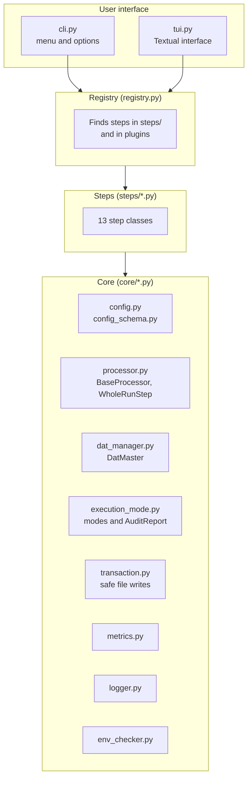

### 14.2 Step base classes

Every step class has a `meta` object (`StepMeta`) and a `run()` method.

| Base class | Use it when | You write |
|---|---|---|
| `BaseProcessor` | The step handles many files, one by one, in parallel | `process_file(path)` |
| `WholeRunStep` | The step works on a whole folder in one run | `run()` |

`BaseProcessor` gives you:

- `scan()` to list files;
- `run_parallel()` to use threads;
- `update_stat()` to count results (use it; it is thread-safe);
- `run_subprocess()` to call a program, with a time limit and optional retries;
- the current mode and the audit report.

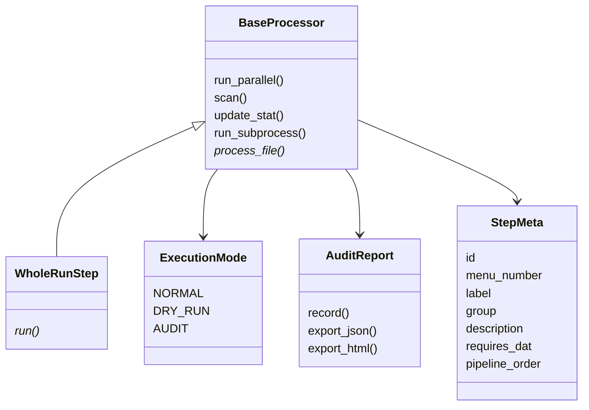

### 14.3 Add a new step

1. Make `src/emupipeline/steps/step_<name>.py`.
2. Make a class. Add the `@register` decorator and a `StepMeta`.
3. Use a free `menu_number`. Use `pipeline_order = 999` for a manual step.
4. In your code, check the mode before you write any file. In `DRY_RUN`, only log. In `AUDIT`, call `self._audit.record(...)`.
5. Add tests in `tests/unit/test_steps/`.

```python
from emupipeline.core.processor import WholeRunStep
from emupipeline.core.registry import register
from emupipeline.core.step_interface import StepMeta


@register
class HelloStep(WholeRunStep):
    meta = StepMeta(
        id="hello",
        menu_number=20,
        label="Say hello",
        group="Extras",
        description="Example step.",
        pipeline_order=999,
    )

    def run(self, **kwargs):
        self.logger.info("Hello")
        self.update_stat("processed")
```

Outside packages can add steps with the entry point group `emupipeline.steps` in their `pyproject.toml`.

### 14.4 Safe file writes

`StagingTransaction` writes to a temporary file first. At the end it renames the file to its final name in one operation. If an error occurs, it deletes the temporary files. Therefore a crash does not leave half-written files.

### 14.5 Tests

```bash
pip install -e ".[dev]"

pytest                 # all tests, with coverage (minimum 75%)
pytest --no-cov -q     # faster, no coverage
pytest tests/unit/test_steps/test_clean.py -v   # one file
```

| Folder | Content |
|---|---|
| `tests/unit/` | Tests for core modules and each step |
| `tests/integration/` | Smoke test of the whole pipeline |
| `tests/e2e/` | Full run with sample data |
| `tests/conftest.py` | Shared fixtures: `tmp_project`, `sample_dat`, `config_factory` |

Use `config_factory` in a test to get an isolated config. It resets the config singleton for you.

### 14.6 Code quality

```bash
ruff check src/ tests/          # lint
ruff format --check src/ tests/ # format
mypy src/emupipeline/           # types
pre-commit install              # run checks before each commit
```

GitHub Actions runs these checks and the tests on Python 3.10, 3.11, and 3.12.

See [CONTRIBUTING.md](CONTRIBUTING.md) for the contribution rules and [CHANGELOG.md](CHANGELOG.md) for the version history.

---

## 15. Glossary

| Term | Meaning |
|---|---|
| **Audit mode** | A mode that records all planned actions in a report. It does not change files. |
| **Bigram** | A pair of letters next to each other. The picture matcher uses bigrams to find similar names fast. |
| **Blacklist** | A list of words. A game with one of these words in its title is removed. |
| **catver.ini** | A file that gives a category to each arcade game. |
| **CHD** | A compressed disc-image format (MAME). |
| **Clone** | A game that is a changed copy of a parent game. |
| **CRF** | "Constant Rate Factor". It sets video quality in ffmpeg. 0 is best and 51 is worst. |
| **CSO / ZSO** | Compressed PSP disc-image formats. |
| **DAT file** | An XML list of correct games and their checksums. |
| **Driver** | The hardware that a game runs on. |
| **Dry run** | A mode that writes log lines only. It does not change files. |
| **EmulationStation** | A game menu program. It reads `gamelist.xml`. |
| **Fuzzy match** | A test that finds names that are almost the same. |
| **gamelist.xml** | The game list file for EmulationStation. |
| **H.265 (HEVC)** | A video codec that makes smaller files than H.264. |
| **IGIR** | A program that checks and sorts ROMs against DAT files. |
| **Menu number** | The number of a step in the menu and in `--step N`. |
| **Merge mode** | How clone games are stored: `nonmerged`, `split`, or `merged`. |
| **Pipeline** | A group of steps that run in a fixed order. |
| **Pipeline order** | A number. Steps with a low number run first. `999` means "manual only". |
| **Port** | A game that runs on Linux directly, or on Windows through Wine. |
| **ROM** | A file that holds a game. |
| **RVZ** | A compressed disc-image format for GameCube and Wii. |
| **Smart skip** | Skip a video when its codec is already correct. |
| **Step** | One task in the pipeline. |
| **Symlink** | A small file that points to another file. It uses almost no disk space. |
| **Upscale** | Make a picture larger with a neural network. |
| **WebP** | A picture format that gives small files. |

---

EmuPipeline 5.0 · [Issues](https://github.com/rtasistemas/evs/issues) · [Releases](https://github.com/rtasistemas/evs/releases) · [Changelog](CHANGELOG.md)
